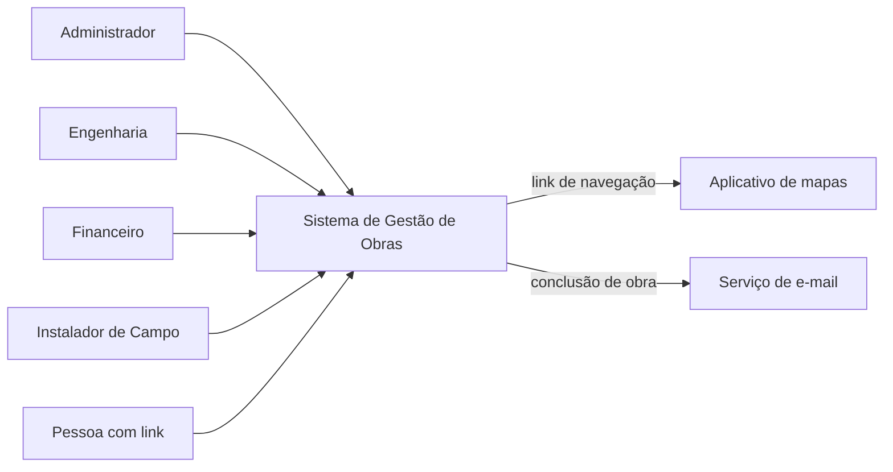
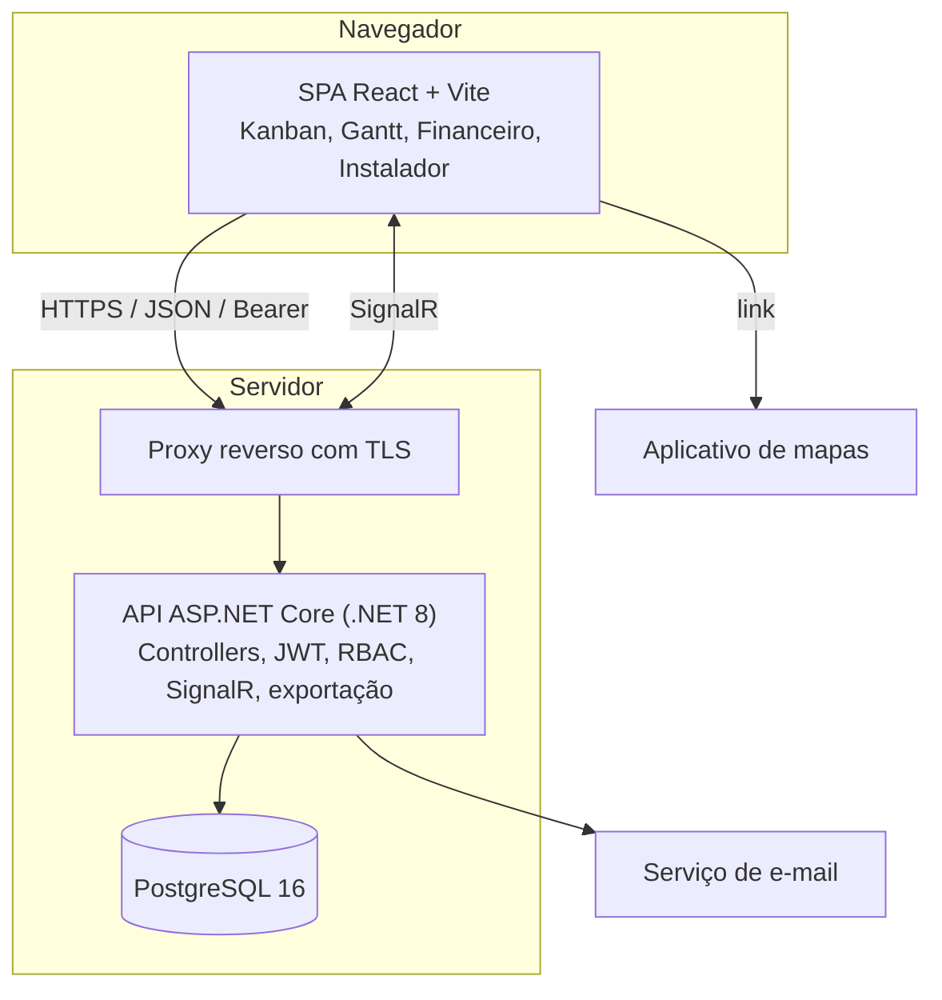

# Arquitetura

## 1. Visão geral

Aplicação web em três partes: uma SPA em React, uma API REST em ASP.NET Core e um banco PostgreSQL. A API é um monolito modular: um único processo com módulos separados por responsabilidade e dependências apenas em um sentido. A decisão está em [decisões arquiteturais](09-decisoes-arquiteturais.md).

Modos de acesso:

| Modo | Dispositivo | Autenticação |
| :---- | :---- | :---- |
| Sistema completo | Desktop e notebook | JWT |
| Instalador de campo | Celular | JWT (conta própria) |
| Cronograma compartilhado | Qualquer | Token de link, somente leitura |
| Modo display | Monitor | JWT, somente leitura |

## 2. Contexto (C4 L1)

## 3. Contêineres (C4 L2)

## 4. Componentes (C4 L3)

### 4.1 Backend

| Módulo | Componentes | Responsabilidade |
| :---- | :---- | :---- |
| Autenticação | `AuthController`, `AuthService`, `AuthorizationMiddleware` | Login, emissão de JWT, validação de token e perfil |
| Obras e Kanban | `ObraController`, `ClienteController`, `ComentarioController`, `RegrasTransicaoService`, `SyncService` | Cadastro, status, cartões, comentários e sincronização |
| Gantt e equipes | `EquipeController`, `GanttController`, `DuracaoService`, `GanttService` | Equipes, alocação, duração, dias úteis e propagação |
| Financeiro | `FinanceiroController`, `CustoService`, `DREController`, `DREService`, `RelatorioController`, `ExportService` | Custos, DRE e exportação |
| Timeline e auditoria | `HistoricoController`, `RegistroAcaoService`, `AuditLogService` | Registros de ação e log imutável |
| Instalador | `InstaladorController`, `ManutencaoController` | Instalações da equipe, manutenção, rota |
| Público | `CronogramaPublicoController` | Cronograma por token, somente leitura |
| Notificação | `EmailService`, `ObraStatusEventHandler` | E-mail de conclusão, de forma assíncrona |

### 4.2 Frontend

| Componente | Responsabilidade | Fonte de dados |
| :---- | :---- | :---- |
| `KanbanBoard`, `KanbanCard`, `KanbanColumn` | Quadro, cartões e arraste | React Query (obras) |
| `GanttView`, `GanttNovaAlocacaoModal` | Barras por equipe, alocação e reordenação | React Query (programações) |
| `CadastrarObra` | Formulário de obra | Mutação de obra |
| Tela financeira | Custos, DRE e exportação | React Query (custos) |
| Tela do instalador | Instalações do dia e rota | React Query (instalador) |
| `RouteGuard` | Proteção de rotas por perfil | Sessão (Zustand) |

## 5. Stack

| Camada | Tecnologia | Uso |
| :---- | :---- | :---- |
| SPA | React, Vite, TypeScript | Interface |
| Roteamento | React Router DOM | Rotas e proteção por perfil |
| Estilo | Tailwind CSS v4, shadcn/ui | Layout responsivo e componentes acessíveis |
| Gantt | DHTMLX Gantt | Barras, arraste e reordenação |
| Kanban | dnd-kit | Arraste com ponteiro e teclado |
| Estado de interface | Zustand | Filtros, modais, item em arraste |
| Dados do servidor | TanStack React Query | Cache e estados de carregamento |
| Formulários | React Hook Form, Zod | Validação |
| HTTP | Axios | Requisições com interceptador de JWT |
| Tempo real | SignalR | Eventos entre Gantt e Kanban |
| API | ASP.NET Core (.NET 8), C# | Regras de negócio e contrato REST |
| Banco | PostgreSQL 16 | Persistência |
| Ambiente local | Docker Compose | Frontend, API e banco com seed |

## 6. Integrações

| Integração | Protocolo | Observação |
| :---- | :---- | :---- |
| Aplicativo de mapas | Link HTTPS | Gerado a partir do endereço da obra; abre o app do dispositivo |
| Serviço de e-mail | SMTP ou API | Provedor a definir. Falha não bloqueia a operação |
| SignalR | WebSocket | Eventos de status e de alocação |

## 7. Segurança

**Autenticação.** JWT assinado, com expiração configurável por `JWT_EXPIRES_MINUTES`. Senhas com hash bcrypt. Bloqueio temporário após 5 falhas consecutivas. Mensagem de erro de login genérica.

**Autorização.** Middleware valida token e perfil em toda rota protegida. O frontend oculta ações, mas a decisão é sempre do servidor. Instalador só acessa dados da própria equipe, filtrados no servidor.

**Transporte.** HTTPS obrigatório (TLS 1.2+). Nenhuma rota HTTP em produção.

**Segredos.** Nenhum segredo em código, imagem ou log. Credenciais de teste ficam somente no ambiente de desenvolvimento.

**Ameaças principais.**

| Ameaça | Exemplo | Controle |
| :---- | :---- | :---- |
| Força bruta no login | Tentativas repetidas de senha | Bloqueio após 5 falhas; mensagem genérica |
| Elevação de privilégio | Instalador chama mudança de status | RBAC em toda rota |
| Acesso a objeto de outro usuário | Obra de outra equipe por ID | Filtro por equipe no servidor |
| Link vazado | Cronograma compartilhado | Token com expiração e revogação; sem dados financeiros |
| Alteração sem rastro | Mudança de custo sem autor | `audit_log` append-only |

**Dados pessoais.** Nome, CPF/CNPJ, telefone, e-mail e endereço de clientes e instaladores. Logs não registram senha, token nem CPF/CNPJ completo.

## 8. Dados

Modelo relacional descrito em [modelo de dados](06-modelo-dados.md). Classificação: dados de cliente e financeiros são confidenciais. Cadastros operacionais são internos.

## 9. Observabilidade

| Indicador | Meta |
| :---- | :---- |
| Tempo de resposta do login | P95 ≤ 500 ms |
| Tempo de exportação (1.000 registros) | P95 ≤ 5 s |
| Erros 5xx | ≤ 0,5% das requisições |
| Requisições negadas (401 e 403) | 100% registradas |
| Alterações críticas | 100% com registro em `audit_log` |

Logs estruturados com usuário, rota, status e duração. Ferramenta de métricas e alertas a definir.

## 10. Implantação

- **Desenvolvimento:** Docker Compose com frontend, API e PostgreSQL. Seed carregado na criação do volume.
- **Produção:** a definir (provedor, região, rede privada para o banco). Proxy reverso com TLS na entrada.
- **Estratégia de deploy:** rolling para a API, com verificação de saúde antes de retirar a versão anterior.
- **Migrations:** versionadas e reversíveis. Ferramenta a definir.
- **Pipeline:** build, testes, secrets scan, SAST e SCA antes de cada deploy.

## 11. Escalabilidade

- A API é stateless (autenticação por JWT), então pode ser replicada atrás do proxy.
- O SignalR precisa de backplane quando houver mais de uma instância.
- A carga prevista é baixa. O maior custo conhecido é a exportação de 1.000 registros.
- Revisar a arquitetura se o P95 de exportação passar de 5 s ou se a CPU ficar acima de 70% de forma sustentada.

## 12. Recuperação de desastre

| Parâmetro | Valor |
| :---- | :---- |
| RTO | A definir |
| RPO | A definir |
| Backup | Diário do banco, com retenção a definir |
| Teste de restauração | Obrigatório antes da produção |

## 13. Dependências

| Biblioteca | Licença | Observação |
| :---- | :---- | :---- |
| React, Vite, React Router, Tailwind CSS, shadcn/ui, dnd-kit, Zustand, TanStack Query, React Hook Form, Zod, Axios, SignalR, ASP.NET Core | MIT | — |
| PostgreSQL | PostgreSQL License | — |
| DHTMLX Gantt | GPL ou comercial | Verificar licença antes da produção (ver [decisões](09-decisoes-arquiteturais.md)) |

Versões devem ser fixadas no lockfile e no `.csproj`.
