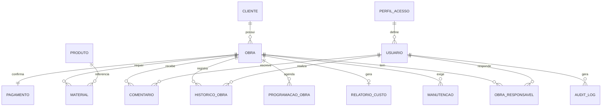

# Modelo de Dados

Banco PostgreSQL. Nomes de tabelas e colunas em `snake_case`. No JSON da API, os mesmos campos são expostos em `camelCase`.

## Entidades

### cliente

| Coluna | Tipo | Obrigatório | Observação |
| :---- | :---- | :---- | :---- |
| id | serial | Sim | PK |
| nome | varchar | Sim | |
| cpf_cnpj | varchar | Sim | Único |
| cidade | varchar | Não | |
| endereco | varchar | Não | |
| telefone | varchar | Não | |
| email | varchar | Não | |
| dados_contrato | text | Não | |

### perfil_acesso

| Coluna | Tipo | Obrigatório | Observação |
| :---- | :---- | :---- | :---- |
| id | serial | Sim | PK |
| nome_perfil | varchar | Sim | `Administrador`, `Engenharia`, `Financeiro`, `InstaladorCampo` |
| permissoes | text | Não | |

### usuario

| Coluna | Tipo | Obrigatório | Observação |
| :---- | :---- | :---- | :---- |
| id | serial | Sim | PK |
| nome | varchar | Sim | |
| email | varchar | Sim | Único |
| senha_hash | varchar | Sim | bcrypt |
| id_perfil | int | Sim | FK `perfil_acesso` |
| ativo | boolean | Sim | Padrão `true` |
| tentativas_login | int | Sim | Zerado no login válido |
| bloqueado_ate | timestamp | Não | Preenchido após 5 falhas |

### obra_responsavel

Relação N:N entre `obra` e `usuario`. Substitui as tabelas `equipe` e `equipe_instalador`, removidas na revisão de 07/11/2026. Um usuário pode ser responsável por várias obras, e uma obra pode ter vários responsáveis.

| Coluna | Tipo | Observação |
| :---- | :---- | :---- |
| id_obra | int | FK `obra`, parte da PK |
| id_usuario | int | FK `usuario`, parte da PK. Qualquer perfil ativo nesta fase |

### obra

| Coluna | Tipo | Obrigatório | Observação |
| :---- | :---- | :---- | :---- |
| id | serial | Sim | PK |
| status | varchar | Sim | Valores em [domínios](#domínios) |
| categoria | varchar | Não | Residencial, Comercial |
| quantidade_paineis | int | Sim | Maior que zero |
| quantidade_inversores | int | Não | A adicionar ao schema |
| endereco | varchar | Sim | Usado no link de navegação. A adicionar ao schema. Origem em definição (Q9) |
| descricao | text | Não | |
| data_inicio_estimada | date | Não | |
| data_fim_estimada | date | Não | Não pode ser anterior à data de início |
| data_inicio_real | date | Não | |
| data_fim_real | date | Não | |
| id_cliente | int | Sim | FK `cliente` |
| excluida_em | timestamp | Não | Exclusão lógica |

### pagamento

| Coluna | Tipo | Obrigatório | Observação |
| :---- | :---- | :---- | :---- |
| id | serial | Sim | PK |
| data_confirmacao | date | Sim | Visível somente a Administrador e Financeiro (RF-26) |
| prazo_contratual_dias | int | Sim | Prazo logístico, visível na gestão de obras |
| id_obra | int | Sim | FK `obra`, UNIQUE (1:1) |

### produto

Catálogo mantido pelo Financeiro e pelo Administrador (RF-25). Preço visível somente a Administrador e Financeiro.

| Coluna | Tipo | Obrigatório | Observação |
| :---- | :---- | :---- | :---- |
| id | serial | Sim | PK |
| nome | varchar | Sim | |
| tipo | varchar | Sim | Ex.: painel, inversor, cabo, disjuntor |
| unidade | varchar | Sim | Ex.: un, m |
| preco_unitario | numeric(12,2) | Sim | Visível somente a Administrador e Financeiro |
| ativo | boolean | Sim | Padrão `true`. Produto inativo não entra em novas inclusões |

### material

| Coluna | Tipo | Obrigatório | Observação |
| :---- | :---- | :---- | :---- |
| id | serial | Sim | PK |
| id_produto | int | Sim | FK `produto`. Substitui o campo `tipo` |
| quantidade | int | Sim | |
| quantidade_utilizada | int | Não | Para balanço de materiais. A adicionar ao schema |
| custo_unitario | numeric(12,2) | Não | Preço do produto na inclusão na obra; visível somente a Administrador e Financeiro. Ver Q13. A adicionar ao schema |
| status_logistico | varchar | Sim | `EmSolicitacao`, `Comprado`, `EmTransito`, `Disponivel`, `Utilizado`. Padrão `EmSolicitacao` |
| id_obra | int | Sim | FK `obra` |

### programacao_obra

| Coluna | Tipo | Obrigatório | Observação |
| :---- | :---- | :---- | :---- |
| id | serial | Sim | PK |
| data_inicio | date | Sim | |
| data_fim | date | Sim | Dia útil |
| prioridade | int | Não | Ordem de propagação dentro da linha do Gantt (ver Q10) |
| duracao_estimada_dias | numeric(5,1) | Não | |
| id_obra | int | Sim | FK `obra` |

### comentario

| Coluna | Tipo | Obrigatório | Observação |
| :---- | :---- | :---- | :---- |
| id | serial | Sim | PK |
| descricao | text | Sim | Não vazio |
| data_registro | timestamp | Sim | Padrão `now()` |
| id_obra | int | Sim | FK `obra` |
| id_usuario | int | Sim | FK `usuario` |
| tipo | varchar | Sim | `Cartao` (comentário de gestão da obra, criado na página Obras), `Manutencao` ou `Timeline` |

### historico_obra

Registro de ações da timeline. Somente INSERT.

| Coluna | Tipo | Obrigatório | Observação |
| :---- | :---- | :---- | :---- |
| id | bigserial | Sim | PK |
| tipo_acao | varchar | Sim | `Cadastro`, `MudancaStatus`, `Comentario`, `ManutencaoConcluida`, `AlteracaoFinanceira`. A adicionar ao schema |
| status_anterior | varchar | Não | |
| status_novo | varchar | Não | |
| observacao | text | Não | |
| data_alteracao | timestamp | Sim | |
| id_obra | int | Sim | FK `obra` |
| id_usuario | int | Sim | FK `usuario` |

### relatorio_custo

| Coluna | Tipo | Obrigatório | Observação |
| :---- | :---- | :---- | :---- |
| id | serial | Sim | PK |
| custo_mao_obra | numeric(12,2) | Não | |
| custo_insumos | numeric(12,2) | Não | |
| custo_total | numeric(12,2) | Não | Soma dos itens |
| valor_obra | numeric(12,2) | Não | Valor cobrado do cliente |
| id_obra | int | Sim | FK `obra`, UNIQUE (1:1) |

Precificação completa: `custo_mao_obra`, `custo_insumos` e `valor_obra` preenchidos.

### manutencao

| Coluna | Tipo | Obrigatório | Observação |
| :---- | :---- | :---- | :---- |
| id | serial | Sim | PK |
| descricao | text | Sim | |
| status | varchar | Sim | `Pendente`, `Concluida` |
| data_conclusao | timestamp | Não | |
| id_obra | int | Sim | FK `obra` |

### audit_log

Log de auditoria. Somente INSERT. Sem UPDATE nem DELETE, nem para o Administrador.

| Coluna | Tipo | Obrigatório | Observação |
| :---- | :---- | :---- | :---- |
| id | bigserial | Sim | PK |
| id_usuario | int | Não | Nulo em falha de autenticação |
| acao | varchar | Sim | Ex.: `StatusAlterado`, `ObraExcluida`, `AcessoNegado` |
| entidade | varchar | Sim | Ex.: `obra`, `relatorio_custo` |
| entidade_id | int | Não | |
| detalhes | jsonb | Não | Sem dados sensíveis |
| timestamp | timestamptz | Sim | |

## Domínios

| Campo | Valores |
| :---- | :---- |
| `obra.status` | `MaterialComprado`, `NoDeposito`, `Separado`, `EmAndamento`, `Concluido`, `Assistencia` |
| `material.status_logistico` | `EmSolicitacao`, `Comprado`, `EmTransito`, `Disponivel`, `Utilizado` |
| `perfil_acesso.nome_perfil` | `Administrador`, `Engenharia`, `Financeiro`, `InstaladorCampo` |
| `comentario.tipo` | `Cartao`, `Manutencao`, `Timeline` |
| `manutencao.status` | `Pendente`, `Concluida` |

## Relacionamentos

## Restrições e índices

| Tabela | Restrição ou índice |
| :---- | :---- |
| `usuario` | UNIQUE (`email`) |
| `cliente` | UNIQUE (`cpf_cnpj`) |
| `pagamento` | UNIQUE (`id_obra`) |
| `relatorio_custo` | UNIQUE (`id_obra`) |
| `obra_responsavel` | PK (`id_obra`, `id_usuario`) |
| `programacao_obra` | Sobreposição proibida por responsável: restrição a implementar por trigger sobre `obra_responsavel` (ver Q10) |
| `obra` | Índice em (`status`) e parcial em `excluida_em IS NULL` |
| `programacao_obra` | Índice em (`id_obra`, `data_inicio`) |
| `historico_obra` | Índice em (`id_obra`, `data_alteracao`) |
| `audit_log` | Índice em (`entidade`, `entidade_id`) |
| Todas as tabelas de ação | Trigger ou permissão que bloqueia UPDATE e DELETE em `historico_obra` e `audit_log` |

## Exclusão lógica

Obra excluída recebe `excluida_em`. Listagens, Gantt e Kanban filtram `excluida_em IS NULL`. Cartão e programações da obra são removidos. Histórico, comentários e custos são preservados.

Cliente com obras vinculadas, inclusive excluídas logicamente, não pode ser removido (RF-23). Os dados de cliente são preservados.
