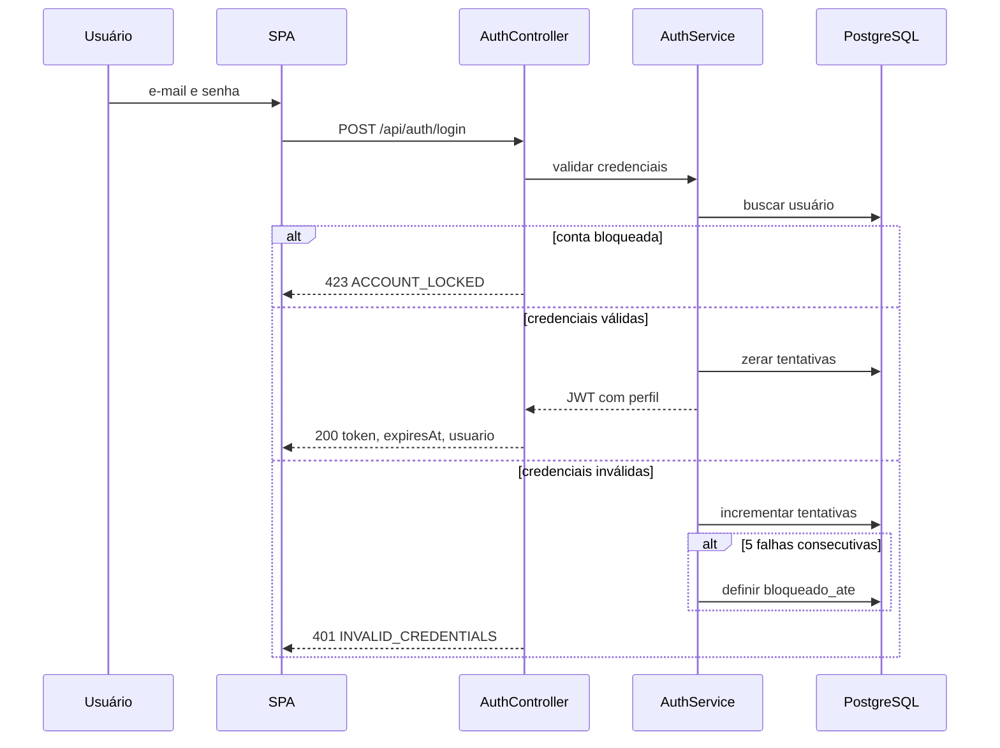
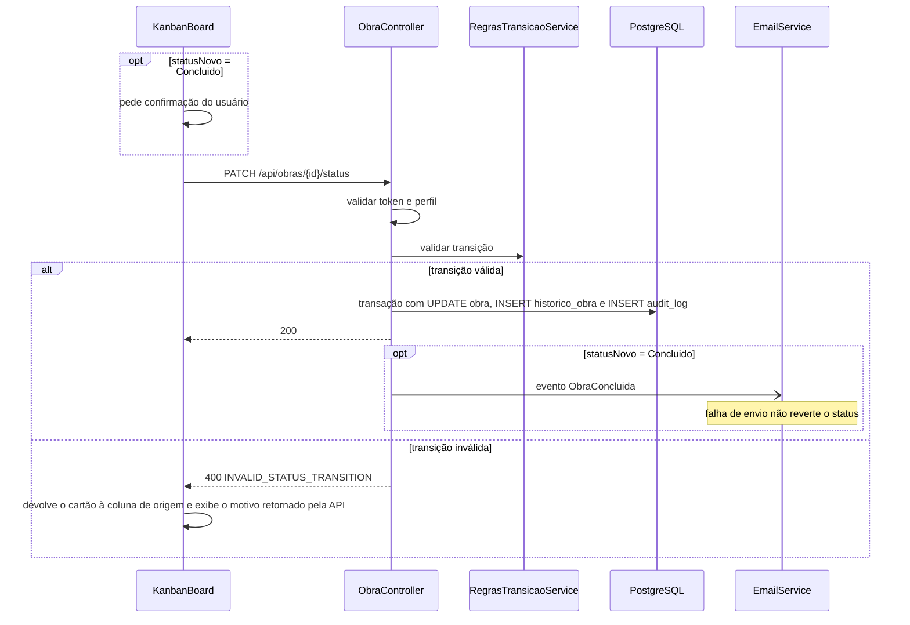
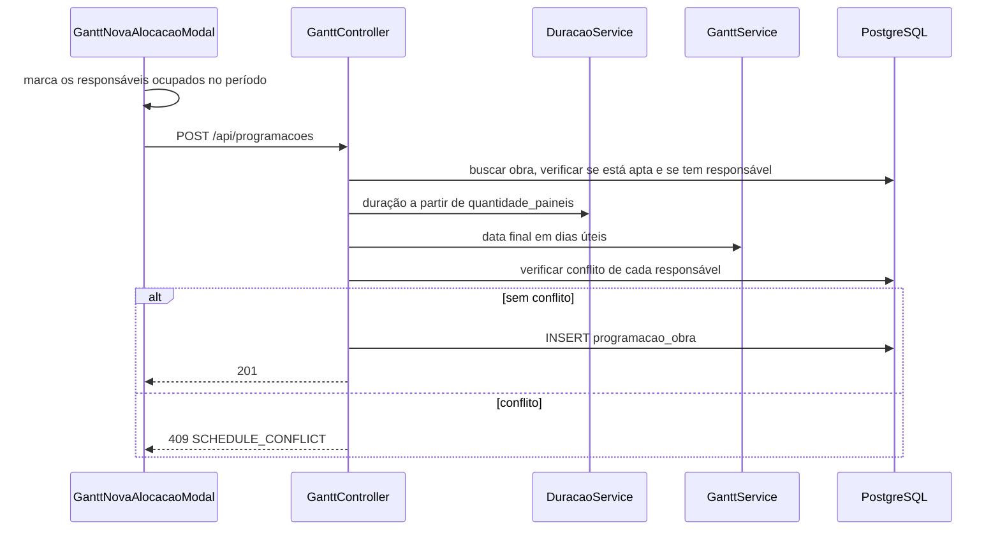

# Fluxos

## Login

## Mudança de status (cartão no Kanban)

O arraste é livre: o cartão pode ser solto em qualquer coluna, e a API valida a transição ao receber a tentativa (Q11).

## Programação de obra no Gantt

## Status de material (Financeiro)

1. O Financeiro abre o material na aba Materiais da obra e escolhe o próximo status.
2. O SPA envia `PATCH /api/materiais/{id}` com `statusNovo`.
3. A API valida a ordem (Q12), grava o novo status e o `audit_log`.
4. O Kanban e o Gantt recebem o evento em tempo real e exibem o novo rótulo e cor.
5. Se a Engenharia enviar a mesma chamada, a API responde `403 ACCESS_DENIED`.

## Alteração de senha autenticada

1. O usuário informa a senha atual, a nova senha e a confirmação.
2. O SPA confere a confirmação e a política mínima antes de enviar.
3. A API valida a senha atual e grava o novo hash em uma única operação.
4. Sucesso: a API invalida os tokens, e o SPA exibe confirmação e leva ao login.
5. Falha: a senha anterior continua válida, e o SPA exibe "Não foi possível alterar a senha. Tente novamente.", sem sugerir link de redefinição.

## Atualização em tempo real

1. A API publica o evento (status alterado, programação criada ou reordenada) pelo SignalR.
2. O handler do frontend recebe o evento e chama `invalidateQueries` ou `setQueryData` do React Query para as chaves afetadas.
3. Gantt e Kanban são redesenhados a partir do cache, sem nova navegação.

## Exclusão lógica de obra

1. Administrador ou Engenharia confirma a exclusão.
2. A API verifica se a obra não está em execução.
3. Em uma transação: define `excluida_em`, remove o cartão e as programações futuras e grava `audit_log`.
4. Histórico, comentários e custos permanecem no banco.
