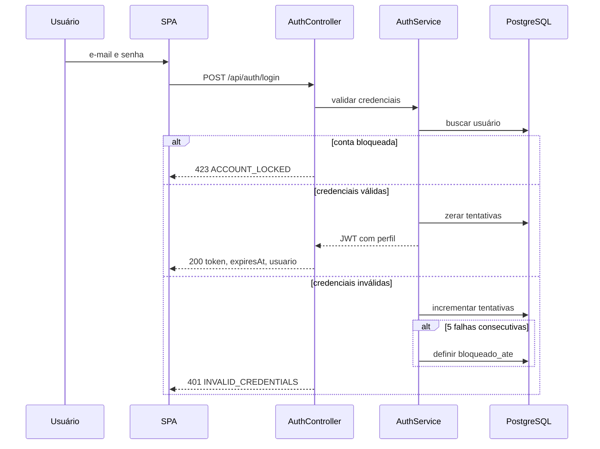
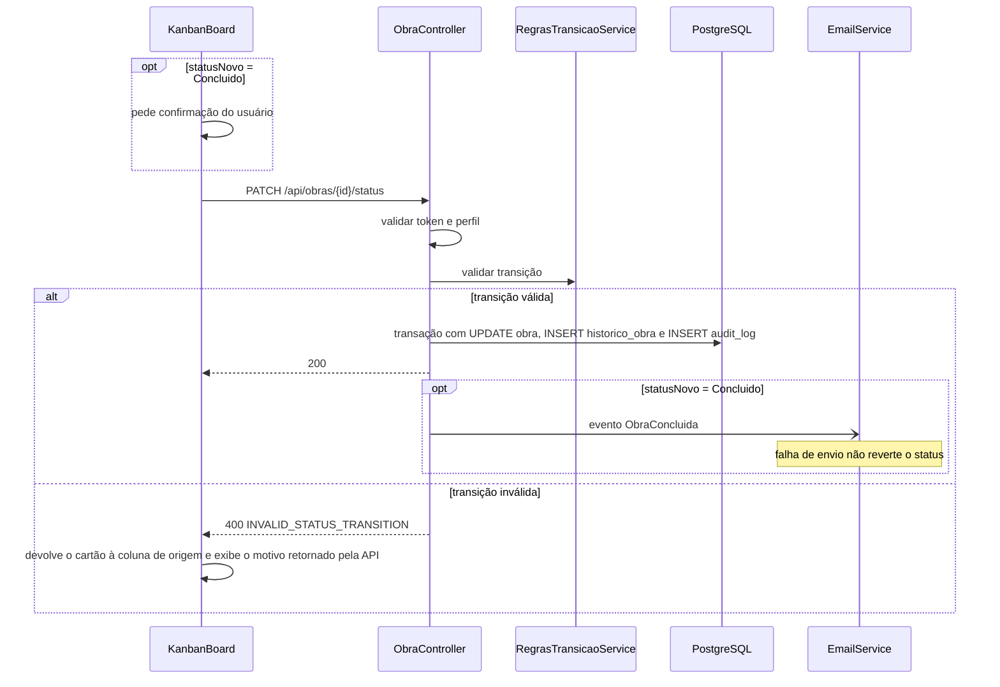
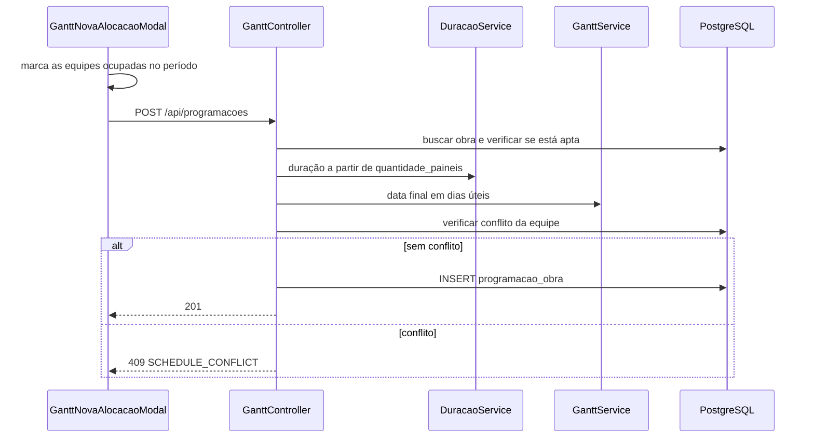

# Fluxos

## Login

## Mudança de status (cartão no Kanban)

## Alocação de equipe no Gantt

## Atualização em tempo real

1. A API publica o evento (status alterado, programação criada ou reordenada) pelo SignalR.
2. O handler do frontend recebe o evento e chama `invalidateQueries` ou `setQueryData` do React Query para as chaves afetadas.
3. Gantt e Kanban são redesenhados a partir do cache, sem nova navegação.

## Exclusão lógica de obra

1. Administrador ou Engenharia confirma a exclusão.
2. A API verifica se a obra não está em execução.
3. Em uma transação: define `excluida_em`, remove o cartão e as programações futuras e grava `audit_log`.
4. Histórico, comentários e custos permanecem no banco.
